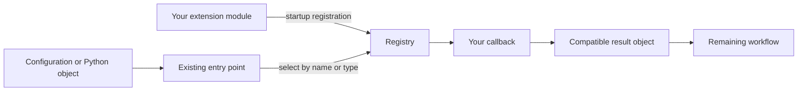

# Extending the interface


Suppose your research needs a particle model, size distribution or output format
that the interface does not provide. An extension lets you supply that missing
behavior and use it through the existing workflow. You write the new behavior;
the interface selects it and connects it to compatible processing steps.

This guide starts with that connection, explains which part to extend, and ends
with a complete calculation using a custom PSD factory. Exact constructor fields
and signatures are in the [function reference](FUNCTION_REFERENCE.md). If the
built-in workflow already meets your needs, start with the
[user manual](USER_MANUAL.md) instead.

## Contents

1. [The overall model](#1-the-overall-model)
2. [How an extension becomes available](#2-how-an-extension-becomes-available)
3. [Choose the part you need to extend](#3-choose-the-part-you-need-to-extend)
4. [Keep the scientific meaning intact](#4-keep-the-scientific-meaning-intact)
5. [Worked example: add a PSD and calculate bulk optics](#5-worked-example-add-a-psd-and-calculate-bulk-optics)

## 1. The overall model

An ordinary research calculation has several different responsibilities:

```text
Scientific request / configuration
    -> identify a particle and locate compatible sources
    -> resolve and interpolate single-particle optical properties
    -> construct a PSD and integrate the optical properties over it
    -> validate the result and write or plot it
```

You usually need to change only one of those responsibilities. A new PSD changes
how the particle population is constructed; it does not require a new optical
integrator. A new model exporter changes how a result is represented for another
application; it need not repeat the calculation. A new particle family requires
more work because its parameters, source layout and adapter behavior must agree.

The connecting mechanism is a **registry**: a mapping from a name or Python type
to an implementation. The public workflow asks the registry for the appropriate
implementation, calls it, and continues with its result.



There are three useful concepts to distinguish:

| Concept | What you provide | PSD example |
|---|---|---|
| Implementation | The function or object that performs the work | A function that converts relative bin counts to a `SizeDistribution` |
| Contract | The expected arguments, return type and responsibilities | `PSDFactory(create)`; `create(config, context)` must return a `SizeDistribution` |
| Registration | A binding that lets a consumer find that implementation | `register_psd("my_psd", PSDFactory(create))` |

Registration does not write new branches into the core, copy your code into the
installed package, or turn an arbitrary function into a complete research model.
It makes a supplied capability discoverable by the consumers that support that
contract. In version 1, `extensions.CONTRACT_VERSION` is `1`.

### Configuration versus extension

First decide whether there is actually new behavior to implement. Changing a
built-in lognormal PSD's radius, concentration or width is configuration. Adding
an algorithm that constructs a different population from new inputs is an
extension. Likewise, choosing another supported shape is configuration; adding
support for a different source representation can require a particle adapter.

Start with the smallest change that answers the research question. You do not
need to implement a particle, PSD, exporter and command together. If your solver
already produces compatible optical arrays, you can construct `SingleParticleOptics`
and integrate them directly; a registered particle family is useful when you also
need profile discovery, source planning and configured population workflows.

## 2. How an extension becomes available

### Define, register, then use

The lifecycle is:

1. Define your callback and any new data types in your own Python module.
2. Register them once when your application starts.
3. Load the configuration or invoke the operation that selects the registered name/type.
4. Inspect the returned objects and diagnostics as you would for a built-in workflow.

For example, a module named `my_extension` can expose an `install()` function.
Your application imports it, calls `my_extension.install()`, then loads the
scheme or starts its workflow. This keeps registration visible and avoids
accidental registration merely from inspecting a module.

The registries exist **inside the current Python process**. Registration is not
saved in a configuration file or a generated NetCDF file. A later process must
load and register the extension again. To reproduce the calculation, share the
extension code/version along with the scientific inputs and configuration.

### Selecting by name or by type

A named registry is appropriate when configuration chooses a capability. For
example, a bulk-table PSD specification containing `"type": "my_psd"` selects a
registered PSD factory. An exporter is selected by the application name passed
to `extensions.export(...)`.

A type registry is appropriate when you introduce a new Python product or scheme.
For example, `register_operation("write", MyProduct, write_my_product)` tells
`zsi.write(product, path)` how to handle an instance of `MyProduct`. Existing
product types continue to use their existing handlers.

Built-ins load before user registrations. A conflicting name, alias or exact-type
handler raises `ExtensionError`; registration does not silently replace an existing
implementation. Named keys ignore case and normalize spaces/hyphens to underscores,
so names such as `my-psd` and `my_psd` collide. Use a distinctive name and register
once per process. Re-running installation cells in a notebook can cause this error;
a fresh kernel gives you a fresh registry.

### Using an extension through the CLI

The installed `zju-scatt` command does not automatically discover third-party
extension modules. A separate shell invocation starts a separate process, so
registering a capability in a notebook does not add it to that shell command.
Use a small launcher that registers your extension before constructing the CLI:

```python
# run_with_extension.py -- requires your own my_extension.py module
import sys
import my_extension
from zju_scatt_interface.cli.main import main

my_extension.install()
raise SystemExit(main(sys.argv[1:]))
```

Then invoke `python run_with_extension.py ...` with the desired CLI arguments.
Register before loading configurations or building the parser. `configure(parser)`
only declares a command's options; execution happens later in `run(args, client)`.

These Python registrations are separate from account registration. They do not
contact the data service, supply credentials or remove the normal session
requirement. Ordinary research operations still require the user's registration,
even when working from local files.

## 3. Choose the part you need to extend

Use the question in the first column to locate your starting point. Import the
contracts and registration functions from `zju_scatt_interface.extensions`.

| What is missing? | Extension point | Where it is used |
|---|---|---|
| A particle family or its source interpretation | `ParticleDefinition` / `register_particle` | Profiles, planning, source validation, interpolation and population/scheme builds |
| A way to construct a PSD from named options | `PSDFactory` / `register_psd` | `create_psd` and configurable bulk-table PSD overrides |
| An application-specific output bundle | `Exporter` / `register_exporter` | `export` and `validate_export` |
| A different Python product or workflow type | `register_operation` | Root `plan`, `build`, `validate`, `write`, `plot` or `interpolate` |
| A native optical-model convention | `NativeModel` / `register_native_model` | Native reading, validation and supported coefficient/phase conversions |
| A single-file storage backend | `register_serializer` | The generic atomic native writer |
| A plot selected by an explicit kind | `register_plotter` | `zsi.plot(product, kind="my_kind")` |
| A new CLI command | `Command` / `register_command` | Parser construction and command execution |

### A particle family: connect the scientific description to source handling

Imagine you have developed a `fractal_soot` family. Giving it a name is only the
first step. The interface also needs to know which parameters are meaningful,
where compatible optical data can be found, and how to resolve a physical request
against those sources. These responsibilities are bound by one `ParticleDefinition`.

Construct that dataclass with a `ParticleProfile` and callbacks. It is not a base
class with a generic `compute()` method. The required pieces work together as follows:

| Piece | Question it answers | Contract |
|---|---|---|
| `profile` | What is this family, and which parameters, units and source schema are valid? | A `config.particles.ParticleProfile` |
| `axes` | Which canonical numeric coordinates are interpolated? | A tuple of parameter names declared in the profile |
| `adapter_factory` | Which object resolves this family's optical sources? | A zero-argument callable returning a `ParticleAdapter` |
| `planner` | Which source query satisfies this scheme component? | `(scheme, component) -> (coordinates, retrieval_parameters)` |
| `calculation_inputs` | Which parameters and RI tables does the build pass to the adapter? | `(component) -> (parameters, refractive_index_tables)` |

For example, planning turns the requested wavelengths/environment into a source
query. During calculation, the adapter's `resolve(...)` selects source requests
and returns an `AdapterResolution`; its `interpolate(...)` produces an
`InterpolatedOpticalProduct` containing standard optical arrays and provenance.
The ordinary population workflow can then integrate those arrays over the PSD.
The adapter contract lives in `sources.adapters.base`, not a `particles.adapter`
module. A genuinely new scattering solver must supply its own validated optical
results; registering a family does not implement that physics.

Use canonical coordinate names such as `wavelength` in `axes`, according to the
actual profile. The radii in an optical array are not automatically another
external interpolation axis. The adapter's `particle_type` must match the profile,
and its `axes` must support every declared numeric axis. Additional categorical
selectors, such as a humidity branch, may be carried separately.

`ParticleProfile.aliases` names the **family**. `ParameterSpec.aliases` names an
individual **parameter**. They are different contracts; a parameter alias does
not create an alias for the family. The ordinary `ParticleComponent` can hold a
registered family, so a separate convenience component class is optional.

Add optional callbacks only for workflows you actually support:

| Optional capability | When it is needed | Responsibility |
|---|---|---|
| `defaults(source_paths, *, preset)` | Reference-population bulk tables | Return explicit parameters, shape/PSD/RI assumptions; absent defaults cause an explicit error |
| `ensemble_axes` | Shape-ensemble table overrides | Declare exactly which axes a member must specify |
| `table_settings(parameters, shapes, refractive)` | Family-specific table settings | Translate the parsed settings and return the three adjusted values |
| `interpolation_policy(target, nodes)` | Extra family constraints or native axis variants | Return `(axes, enforce_profile_bounds)`; source-node coverage still applies |
| `downloaded_interpolator(runtime, processing, selected_sources, destination)` | Reconstructing native products after download | Return product records with the supported `created`/`skipped` status convention |

A family can support explicit local-source calculations without supporting
reference defaults or downloaded native reconstruction. Say which capabilities
exist. For planning, return deterministic, serializable values and use the
existing retrieval parameter contract, including generic custom-parameter filters
where appropriate. A justified native-axis policy does not authorize extrapolation
or invented physical inputs.

For an implementation to inspect, see the
[built-in bindings](../src/sources/adapters/builtins.py) in a source checkout. You do not edit that file
to add your own family. The independent synthetic particle in
[tests/extension_probe.py](../tests/extension_probe.py) shows the actual constructors,
profile reuse, callbacks and adapter binding together.

### A PSD factory: construct a standard population

Choose this when the new behavior is the conversion from named scientific inputs
to a `SizeDistribution`. The factory receives a copied configuration with canonical
`type`, plus `PSDContext(lower_um, upper_um, concentration_cm3, reference,
conditional_reference)`. It validates its own options and returns the distribution.

The context tells the factory the workflow's radius bounds, concentration and
reference-population policy. It does not invent missing physical parameters or
make every custom factory obey coverage automatically. Subsequent bulk-table
construction checks the returned bins against common source coverage and the
selected clipping policy. Center bounds and represented-bin edges are distinct.

Named factory configuration is accepted in bulk-table PSD overrides. Ordinary
scheme mappings continue to use explicit arrays or files: call `create_psd` first
and give the resulting distribution to a `ParticleComponent` when using Python.
The worked example below follows this explicit construction pattern.

### Product handlers, exporters and plots: choose the correct consumer

If you have a new Python `MyProduct` or `MyScheme` type, register handlers for
only the operations it supports. A handler receives the product first, followed
by that operation's arguments. `build` passes `plan=None` unless supplied; a write
handler receives `path`, `wavelength_um=None`, `wavelengths_um=None`, `format=None`
and additional options. Validate or reject options your implementation cannot use.
Return types are defined by your handler; built-in return contracts are unchanged.
Type lookup follows inheritance, allows a more specific subclass handler, and
rejects ambiguous virtual-base matches.

Interpolation is a special case: after the root API checks a nonempty homogeneous
source sequence, its handler receives `(first_source, sources, target,
particle_type=..., **options)`. The first source selects the registered type.

If you already have a standard scientific result and only need an application
layout, an exporter is usually sufficient. `Exporter(write, validate=None)` binds
`write(data, destination, **options)` and optionally `validate(path, **options)`.
Call it through `export("my_application", data, destination, ...)`; use
`validate_export` for its validator. This does not add a new format to every
other writer. Built-in names are `arts`, `crtm_ir`, `rttov13` and `rttov14`;
`rttov13` has no generic exporter-validator binding. See the
[scientific reference](SCIENTIFIC_REFERENCE.md#7-downstream-model-formats) for each
model's output conventions and limits.

For a new plot explicitly selected by name, register a callable with
`register_plotter("my_kind", handler)`; the call
`zsi.plot(product, kind="my_kind", ...)` passes the product and options to it.
A plot selected by a new product's type can instead use an operation handler.

### Native model versus serializer: meaning versus storage

A native **model** defines scientific/layout rules. `NativeModel` requires
`validate(arrays, template)` and may supply `read(path)`, `template(path)`,
`bulk_fields(bulk, **options)`, `phase(angles, p11, **options)` and
`attribute(key, value)`. Asking for an unimplemented capability fails explicitly.

A **serializer** defines how to store the arrays in one file. Its callback is
`serialize(temporary_path, arrays, template)`. The generic native writer validates
the portable version-1 template and arrays, applies model validation, calls the
serializer, then atomically replaces the destination. Write exactly the supplied
temporary file; destination renaming and companion-file bundles do not belong
in that callback. Use an exporter for bundles.

For example, a new single-file backend that preserves existing model conventions
can reuse a native model and add only a serializer. New scientific conventions
can require a new model even if the storage remains NetCDF or HDF5. Incompatible
new template semantics require a contract revision rather than overloading an
existing field.

### Commands: expose a capability after it works in Python

A `Command(name, help, configure, run, validate=None)` contributes a CLI command.
`configure(parser)` declares arguments, optional `validate(args)` checks them,
and `run(args, client)` returns the exit code. It inherits the existing network
defaults and registration policy. Adding a command is optional; it does not make
an otherwise unimplemented particle or exporter work. Use the launcher described
in section 2 to register it before parser construction.

## 4. Keep the scientific meaning intact

Returning the right object type is necessary, but does not establish a valid
physical calculation. When reusing existing kernels, retain their data conventions:

- `SingleParticleOptics` contains physical radii in **um** and dimensional cross
  sections in **m²**. Convert native source conventions correctly at the boundary.
- `SizeDistribution` contains strictly increasing positive radii, an explicit
  size definition, and discrete counts per represented bin in **cm⁻³**.
- The common integrator converts concentration to **m⁻³** internally and returns
  bulk coefficients in **m⁻¹**. Do not convert the concentration a second time.
- Preserve the phase representation, normalization and on-disk ordering required
  by the selected model. Preserve coverage decisions and provenance as well.

Test two things separately. **Contract tests** establish that registration, lookup,
invalid-input handling and outputs work. **Scientific tests** establish that the
algorithm agrees with trusted values and retains its units, conservation relations
and intended population. A synthetic registration demo proves the former only.
For a particle implementation, compare known optical slices and integrated results;
for an exporter, read the files back and compare values and axes.

The existing [extension acceptance test](../tests/test_extensions.py) imports
`extension_probe.py` in a fresh process. It exercises all extension categories,
compares a synthetic family with its built-in counterpart, rejects collisions and
invalid output, and checks that existing package source files remain unchanged.
It is a useful advanced reference after you understand one complete example.

## 5. Worked example: add a PSD and calculate bulk optics

### The research task and the extension boundary

Suppose you repeatedly start from radii `[0.5, 1.0, 2.0]` um and relative **number**
weights `[1, 2, 3]`. You want to reuse those proportions at a chosen total number
concentration. At `6 cm-3`, the bins should contain `[1, 2, 3] cm-3`; at `12 cm-3`,
they should contain `[2, 4, 6] cm-3`.

You need a named population constructor, not a new particle adapter or integrator.
The new callback allocates total concentration among bins. The existing integrator
then consumes the resulting `SizeDistribution` in exactly its ordinary way.

The complete runnable file is
[example_18_custom_psd_extension.py](../examples/example_18_custom_psd_extension.py).
The following excerpts show the connection; the file also validates inputs and
saves its evaluated configuration, PSD, remapping and QA results.

### Step 1: implement the population rule

The callback signature is `weighted_bins(config, context)`. It rejects unknown
keys, unequal array lengths, negative/non-finite weights, an all-zero weight
vector and invalid total concentration. `SizeDistribution` validates the radius
ordering and resulting per-bin counts. The allocation itself is:

```python
import math
from zju_scatt_interface.psd.models import SizeDistribution

def weighted_bins(config, context):
    """Allocate the context's total concentration using explicit relative counts."""
    unknown = set(config) - {"type", "radii_um", "number_weights"}
    if unknown:
        raise ValueError(f"Unknown weighted-bin options: {sorted(unknown)}")
    radii = list(config["radii_um"])
    weights = [float(value) for value in config["number_weights"]]
    if not radii or len(radii) != len(weights):
        raise ValueError("Provide one number weight for each radius")
    if any(not math.isfinite(value) or value < 0 for value in weights):
        raise ValueError("Number weights must be finite and nonnegative")
    total_weight = math.fsum(weights)
    concentration = float(context.concentration_cm3)
    if not math.isfinite(total_weight) or total_weight <= 0:
        raise ValueError("At least one number weight must be positive")
    if not math.isfinite(concentration) or concentration <= 0:
        raise ValueError("Total concentration must be finite and positive")
    psd = SizeDistribution(
        radii,
        [concentration * value / total_weight for value in weights],
        source="tutorial_weighted_bins",
        metadata={"number_weights": weights},
    )
    if any(not context.lower_um <= radius <= context.upper_um for radius in psd.size_um):
        raise ValueError("PSD centers exceed the supplied radius context")
    return psd
```

The weights are relative **bin counts**, not `dN/dr` samples or mass fractions.
The callback checks centers against the supplied context; full represented-bin
source coverage remains a later workflow responsibility.

### Step 2: bind a name to that implementation

The file defines an `install_extension()` function containing:

```python
from zju_scatt_interface.extensions import PSDFactory, register_psd

# weighted_bins is the callback defined in step 1.
register_psd("tutorial_weighted_bins", PSDFactory(weighted_bins))
```

Call this once before consuming the configuration. Registration supplies a name;
it does not construct a PSD or run an optical calculation yet.

### Step 3: use the name to construct an ordinary PSD

After registration, the consumer can select the factory through configuration:

```python
from zju_scatt_interface.extensions import PSDContext, create_psd

config = {
    "type": "tutorial_weighted_bins",
    "radii_um": [0.5, 1.0, 2.0],
    "number_weights": [1.0, 2.0, 3.0],
}
context = PSDContext(lower_um=0.1, upper_um=3.0, concentration_cm3=6.0)
psd = create_psd(config, context)
```

`create_psd` resolves the name, calls the callback, and checks its return type.
The result is an ordinary `SizeDistribution`, so existing calculations do not
need to know which factory constructed it. To use the same rule in a bulk table,
put `config` under the desired species' `psd` override after installing the
extension. The table workflow supplies its own context and coverage checks.

### Step 4: integrate and check a known result

The full example supplies three synthetic optical samples at the same radii,
with extinction cross sections `[1, 2, 4] × 10⁻¹² m²`, SSA `0.5` and asymmetry
`0.3`. It then calls the existing operations:

```python
import zju_scatt_interface as zsi

optics = zsi.SingleParticleOptics(
    sizes=[0.5, 1.0, 2.0],
    extinction_cross_section=[1e-12, 2e-12, 4e-12],
    scattering_cross_section=[0.5e-12, 1e-12, 2e-12],
    absorption_cross_section=[0.5e-12, 1e-12, 2e-12],
    asymmetry_factor=[0.3, 0.3, 0.3],
    size_unit="um", cross_section_unit="m2",
)
bulk, remap = zsi.integrate(
    optics, psd,
    database_size_definition=psd.size_definition,
    truncation_policy="error",
)
quality = zsi.validate(bulk)
```

The expected extinction coefficient can be checked by hand:

```text
(1 × 1 + 2 × 2 + 3 × 4) × 10^-12 m² × 10^6 m^-3 per cm^-3
= 17 × 10^-6 m^-1
```

The example checks that value, runs physical QA, and records the inputs and
outputs. No new integral, unit conversion or scientific-output class was needed.

### Step 5: run it and interpret the output

Install the interface and complete registration if you have not already done so.
From a downloaded source checkout:

```console
pip install zju-scatt-interface
zju-scatt register
python examples/example_18_custom_psd_extension.py --output extension_demo/summary.json
```

If you already have a valid saved session, reuse it. The example needs no optical
downloads and can use that session offline. Expected numerical output is:

```text
Counts: [1.0, 2.0, 3.0] cm-3
Extinction: 1.7e-05 m-1
SSA: 0.5; QA passed: True
```

Inspect `summary.json` for the evaluated PSD and source/remapping metadata. Change
the concentration in `PSDContext` to `12.0` and run in a fresh process: extinction
should double, while SSA and asymmetry stay unchanged. A negative weight should
fail before integration; installing the same name twice in one process should
raise `ExtensionError`.

The optical samples are teaching fixtures, not a scattering calculation for a
real material. Passing this example establishes the extension wiring and a known
discrete sum; it does not establish source-grid or phase convergence. A real study
must supply validated optical data and appropriate numerical diagnostics. Keep
the extension module, its version, configuration and data together so another
researcher can register the same behavior and reproduce the calculation.
